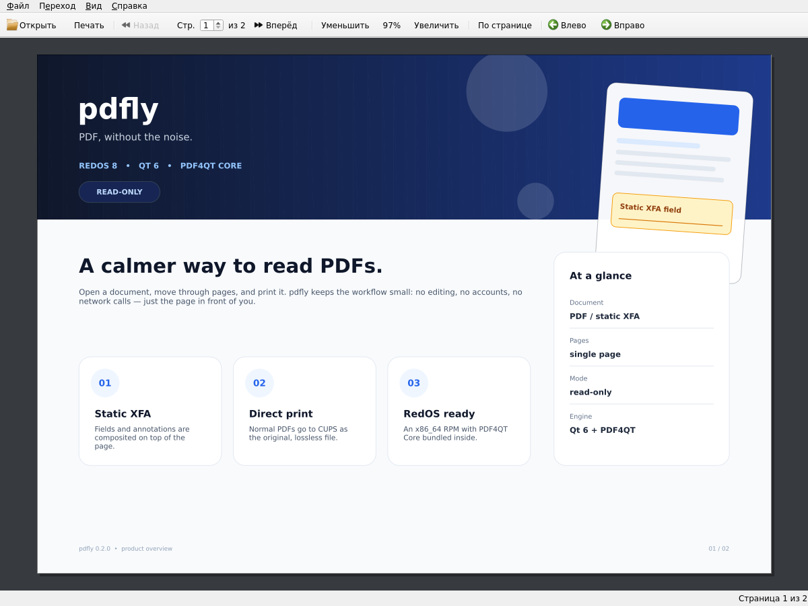
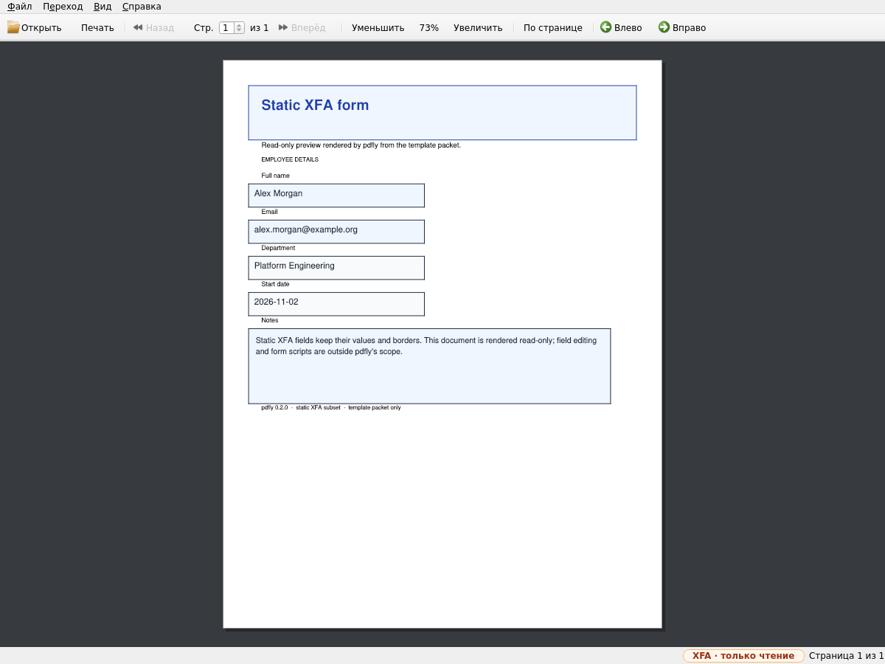

<div align="center">
  
  <h1>pdfly</h1>
  <p><strong>Lightweight, read-only PDF viewer for Linux</strong><br>
  Static XFA forms, clean page rendering, and direct or flattened CUPS printing.</p>

  <p>
    <a href="https://github.com/flytimopheev-sketch/pdfly/releases/latest"></a>
    <a href="LICENSE"></a>
    <a href="https://github.com/flytimopheev-sketch/pdfly"></a>
    
  </p>

  <p><a href="README.md">Русский</a> · <strong>English</strong></p>
</div>



A small, read-only Linux PDF viewer built with **C++20, Qt 6 Widgets and
PDF4QT**. It displays a single PDF page at a time, composites static XFA forms
and annotations through PDF4QT, and prints through CUPS. The application
interface is fully Russian.

The project deliberately uses PDF4QT Core directly instead of the heavier
PDF4QT viewer application/library. The rendering paths for the screen and for
printing are therefore explicit and easy to audit.

## Features

- Open normal PDFs and static XFA forms (read-only).
- XFA pagination is applied through `PDFFormManager::performPaging()`, so the
  page count and page sizes reported by the XFA engine are used for display and
  printing.
- Page display is rendered by PDF4QT into a `QImage`; annotations and XFA are
  drawn on top with `PDFAnnotationManager::drawPage()`.
- Password-protected documents prompt for a password.
- Zoom in/out, actual size, fit width, fit page, and Ctrl+wheel zoom.
- Page navigation with toolbar, menu, keyboard, and drag-and-drop.
- Rotate the current page clockwise or counterclockwise, with a reset action.
  Rotation affects the view only; the original PDF is never modified.
- Full-screen mode (`F11`, exit with `Esc`).
- Document properties with path, file size, page count, page size, XFA, and
  encryption status.
- CUPS printing with two modes:
  1. **Direct PDF** – streams the original PDF bytes to CUPS. This is the
     lossless, vector-preserving path. It always prints all pages.
  2. **Flatten** – renders one page at a time with PDF4QT, including XFA and
     annotations, wraps each page in an exact-size single-page PDF, and streams
     the pages as documents of one CUPS job. This is the fallback for XFA and
     for PDFs whose fields/edges do not print correctly.
- Flatten mode supports page ranges and 150/300/600 DPI.
- `print-scaling=fit` is enabled by default in both modes to prevent printer
  cropping of fields near the paper edge.
- The flatten renderer uses the full rotated **MediaBox** (not the CropBox) and
  print annotation filtering, so page edges and print-only content are kept.

## Screenshots

| Main window | Static XFA |
| --- | --- |
|  |  |

## Keyboard shortcuts

| Action | Shortcut |
| --- | --- |
| Open PDF | `Ctrl+O` |
| Print | `Ctrl+P` |
| Document properties | `Ctrl+I` |
| Previous / next page | `Page Up` / `Page Down` |
| First / last page | `Ctrl+Home` / `Ctrl+End` |
| Zoom in / out | `Ctrl++` / `Ctrl+-` |
| Actual size | `Ctrl+0` |
| Fit width / fit page | `Ctrl+8` / `Ctrl+9` |
| Rotate clockwise | `Ctrl+R` |
| Rotate counterclockwise | `Ctrl+Shift+R` |
| Reset rotation | `Ctrl+Alt+R` |
| Full screen | `F11` |
| Exit full screen | `Esc` |

Ctrl+wheel also zooms the page.

## Important limitation: XFA and “lossless”

PDF4QT does not expose a public “flatten XFA” API. Static XFA is rendered from
the XFA engine into a raster page; there is no vector-preserving XFA print path
in PDF4QT. Therefore:

- Normal PDFs are printed losslessly in direct mode (original file bytes).
- XFA forms must use flatten mode. The page geometry, margins, fields, and
  annotations are preserved, and `print-scaling=fit` prevents cropping, but the
  printed text/graphics are rasterized at the selected DPI.
- Dynamic XFA, XFA scripts, calculations, and field editing are not supported.
  Only read-only, simple/static XFA is rendered.

For archival output of an XFA form, print the flattened result to a PDF printer
or use a vendor tool that can convert XFA to static PDF. This viewer does not
modify or save the original document.

PDF4QT implements a subset of static XFA. The included XFA fixture is synthetic
and covers static page geometry, draw text, and a bordered text field; test your
real forms before relying on the viewer for production output.

## Requirements

- Linux with CUPS (the CUPS client library is used directly).
- GCC 11+ or Clang with C++20 support. Tested with GCC 15.2.0.
- CMake 3.21+ and Ninja (or Make).
- Qt 6.7+ development packages: Core, Gui, Widgets. Tested with Qt 6.10.2.
  PDF4QT 1.6 calls `qt_standard_project_setup(I18N_TRANSLATED_LANGUAGES ...)`,
  which was introduced in Qt 6.7.
- CUPS 2.4+ development headers/library (`libcups2-dev` on Debian/Ubuntu).
  Tested with CUPS 2.4.16.
- PDF4QT 1.6.0.0 Core, built and installed separately.
- PDF4QT dependencies: Qt 6 Core/Gui/Svg/Xml/Network, OpenSSL 3, zlib,
  FreeType, OpenJPEG, libjpeg, libpng, Little CMS 2, TBB (on Linux/GCC),
  blend2d, and Clipper2.

`blend2d` and `Clipper2` are the two PDF4QT dependencies that are usually not
available from distribution packages. The instructions below use vcpkg just for
those two libraries and use distribution packages for everything else.

### Ubuntu 26.04 / Debian testing

```bash
sudo apt update
sudo apt install \
  build-essential cmake ninja-build pkg-config git curl zip unzip tar \
  python3 \
  qt6-base-dev qt6-base-dev-tools qt6-svg-dev qt6-tools-dev qt6-l10n-tools \
  libcups2-dev \
  libssl-dev zlib1g-dev libfreetype-dev libopenjp2-7-dev \
  libjpeg-dev libpng-dev libtbb-dev liblcms2-dev
```

Ubuntu 24.04 ships Qt 6.4, which is too old for PDF4QT 1.6. Use a newer
distribution, a newer Qt from the Qt online installer, or build Qt yourself.
For Fedora, install the equivalent `qt6-qtbase-devel`, `qt6-qtsvg-devel`,
`qt6-qttools-devel`, `cups-devel`, `openssl-devel`, `zlib-devel`,
`freetype-devel`, `openjpeg2-devel`, `libjpeg-turbo-devel`, `libpng-devel`,
`tbb-devel`, and `lcms2-devel` packages.

### RedOS 8 x86_64 (RPM release target)

RedOS 8 ships Qt 6.9.3 and GCC 13.3.1, so it satisfies the requirements above.
The published RPM is built and tested against RedOS 8. Install the build
dependencies with:

```bash
sudo dnf install -y \
  gcc-c++ cmake ninja-build git tar gzip rpm-build patchelf python3 \
  qt6-qtbase-devel qt6-qtsvg-devel qt6-qttools-devel cups-devel \
  openssl-devel zlib-devel freetype-devel openjpeg2-devel \
  libjpeg-turbo-devel libpng-devel lcms2-devel tbb-devel
```

`qt6-qttools-devel` provides `Qt6LinguistTools`, which PDF4QT requires during
configuration even for a core-only build.

## Build PDF4QT Core

PDF4QT 1.6 requires C++20, Qt 6, OpenSSL 3, and the libraries listed above.
Build only its core library; the application does not need the PDF4QT widget
stack.

Use vcpkg only for `blend2d` and `Clipper2`; do **not** pass the vcpkg CMake
toolchain to PDF4QT. When PDF4QT sees `VCPKG_TOOLCHAIN`, it calls
`find_package(lcms2 CONFIG REQUIRED)`, but distribution lcms2 packages do not
install a CMake package configuration. Passing only `CMAKE_PREFIX_PATH` lets
PDF4QT find the two vcpkg libraries while it continues to use the system
lcms2, FreeType, OpenJPEG, JPEG, PNG, OpenSSL, and TBB.

The current PDF4QT master reports version 1.6.0.0. This project was validated
with commit `67b6b99`; pin it, because later revisions can change the dependency
set or CMake options.

```bash
export VCPKG_ROOT="$HOME/vcpkg"
export PDF4QT_SRC="$HOME/PDF4QT"
export PDF4QT_ROOT="$HOME/.local/pdf4qt"
export PDF4QT_COMMIT=67b6b9903cb4e318803342f2d428f02e1bb124e3

# One-time vcpkg bootstrap
git clone https://github.com/microsoft/vcpkg.git "$VCPKG_ROOT"
"$VCPKG_ROOT/bootstrap-vcpkg.sh" -disableMetrics

git clone https://github.com/JakubMelka/PDF4QT.git "$PDF4QT_SRC"
git -C "$PDF4QT_SRC" checkout "$PDF4QT_COMMIT"

# Build blend2d and Clipper2 with the versions pinned by PDF4QT's overlay
# ports. Both overlay arguments are required: the general overlay contains
# blend2d, asmjit, and clipper2; the linux overlay contains libpng.
"$VCPKG_ROOT/vcpkg" install blend2d:x64-linux clipper2:x64-linux \
  --overlay-ports="$PDF4QT_SRC/vcpkg/overlays/general" \
  --overlay-ports="$PDF4QT_SRC/vcpkg/overlays/linux"

cmake -S "$PDF4QT_SRC" -B "$PDF4QT_SRC/build" -G Ninja \
  -DCMAKE_BUILD_TYPE=Release \
  -DCMAKE_PREFIX_PATH="$VCPKG_ROOT/installed/x64-linux" \
  -DPDF4QT_BUILD_ONLY_CORE_LIBRARY=ON \
  -DPDF4QT_BUILD_TESTS=OFF \
  -DPDF4QT_ENABLE_OCR=OFF \
  -DPDF4QT_INSTALL_TO_USR=OFF \
  -DCMAKE_INSTALL_PREFIX="$PDF4QT_ROOT"

cmake --build "$PDF4QT_SRC/build" --parallel

# PDF4QT's top-level install rule always references the widgets export header,
# even for a core-only build, where that header is never generated. Create it
# so the install succeeds; the viewer never includes the widgets headers.
touch "$PDF4QT_SRC/build/pdf4qtlibwidgets_export.h"
cmake --install "$PDF4QT_SRC/build"
```

`PDF4QT_INSTALL_TO_USR=OFF` is important: without it PDF4QT can install into
`<prefix>/usr/include/...`, which this project does not search.

PDF4QT installs its public headers to
`$PDF4QT_ROOT/include/Pdf4QtLibCore` and the shared library to
`$PDF4QT_ROOT/lib`. It does not install a CMake package configuration, so the
viewer's `CMakeLists.txt` locates the headers and library directly.

If you use a different PDF4QT revision, check its
`vcpkg/overlays/general` directory and install only the dependencies that
revision declares.

### RedOS 8 without vcpkg

The RPM release is built without vcpkg. Build the two missing libraries as
static, position-independent libraries and install them into `/opt/pdfqt-deps`:

```bash
export PDFQT_DEPS=/opt/pdfqt-deps
sudo mkdir -p "$PDFQT_DEPS"

git clone https://github.com/blend2d/blend2d.git /tmp/blend2d
git -C /tmp/blend2d checkout 6dbc2cefbc996379e07104e34519a440b49b15d7
cmake -S /tmp/blend2d -B /tmp/blend2d-build -G Ninja \
  -DCMAKE_BUILD_TYPE=Release \
  -DCMAKE_POSITION_INDEPENDENT_CODE=ON \
  -DBLEND2D_STATIC=ON \
  -DBLEND2D_NO_JIT=ON \
  -DBLEND2D_TEST=OFF \
  -DBLEND2D_DEMOS=OFF \
  -DCMAKE_INSTALL_PREFIX="$PDFQT_DEPS"
cmake --build /tmp/blend2d-build --parallel
sudo cmake --install /tmp/blend2d-build

git clone https://github.com/AngusJohnson/Clipper2.git /tmp/clipper2
git -C /tmp/clipper2 checkout Clipper2_2.0.1
# GCC 13 reports a false maybe-uninitialized warning in this release.
sed -i 's/int ec;/int ec = 0;/' \
  /tmp/clipper2/CPP/Clipper2Lib/src/clipper.triangulation.cpp
cmake -S /tmp/clipper2/CPP -B /tmp/clipper2-build -G Ninja \
  -DCMAKE_BUILD_TYPE=Release \
  -DCMAKE_POSITION_INDEPENDENT_CODE=ON \
  -DCLIPPER2_EXAMPLES=OFF \
  -DCLIPPER2_TESTS=OFF \
  -DCLIPPER2_UTILS=OFF \
  -DBUILD_SHARED_LIBS=OFF \
  -DCMAKE_INSTALL_PREFIX="$PDFQT_DEPS"
cmake --build /tmp/clipper2-build --parallel
sudo cmake --install /tmp/clipper2-build
```

`CMAKE_POSITION_INDEPENDENT_CODE=ON` is required: without it the final link of
the shared PDF4QT library fails with `relocation R_X86_64_32S ... recompile
with -fPIC`.

Now build PDF4QT itself. On RedOS 8 the library is installed into `lib64`:

```bash
export PDF4QT_SRC="$HOME/PDF4QT"
export PDF4QT_ROOT=/opt/pdf4qt
export PDF4QT_COMMIT=67b6b9903cb4e318803342f2d428f02e1bb124e3

git clone https://github.com/JakubMelka/PDF4QT.git "$PDF4QT_SRC"
git -C "$PDF4QT_SRC" checkout "$PDF4QT_COMMIT"

cmake -S "$PDF4QT_SRC" -B "$PDF4QT_SRC/build" -G Ninja \
  -DCMAKE_BUILD_TYPE=Release \
  -DCMAKE_PREFIX_PATH="$PDFQT_DEPS" \
  -DPDF4QT_BUILD_ONLY_CORE_LIBRARY=ON \
  -DPDF4QT_BUILD_TESTS=OFF \
  -DPDF4QT_ENABLE_OCR=OFF \
  -DPDF4QT_INSTALL_TO_USR=OFF \
  -DCMAKE_INSTALL_PREFIX="$PDF4QT_ROOT"

cmake --build "$PDF4QT_SRC/build" --parallel

touch "$PDF4QT_SRC/build/pdf4qtlibwidgets_export.h"
sudo cmake --install "$PDF4QT_SRC/build"
```

The viewer expects `libPdf4QtLibCore.so*` in `/opt/pdf4qt/lib64`; the RPM spec
also accepts `/opt/pdf4qt/lib`.

### If vcpkg manifest mode is preferred

PDF4QT also has a `vcpkg.json`. Manifest mode builds its whole dependency graph
(including Tesseract unless OCR is disabled) and takes much longer; it is not
needed for a core-only build. If you use it, keep
`-DPDF4QT_BUILD_ONLY_CORE_LIBRARY=ON`, `-DPDF4QT_ENABLE_OCR=OFF`, and
`-DPDF4QT_INSTALL_TO_USR=OFF`. Qt must still be discoverable by CMake, normally
from the distribution packages.

## Build the viewer

```bash
export PDF4QT_ROOT="$HOME/.local/pdf4qt"

cmake -S . -B build -G Ninja \
  -DCMAKE_BUILD_TYPE=Release \
  -DPDF4QT_ROOT="$PDF4QT_ROOT"

cmake --build build --parallel
./build/pdfly
```

The application resolves the PDF4QT shared library through its build/install
RPATH. You can also use:

```bash
LD_LIBRARY_PATH="$PDF4QT_ROOT/lib:$LD_LIBRARY_PATH" ./build/pdfly
```

To install:

```bash
sudo cmake --install build --prefix /usr/local
```

The installed executable has an RPATH to the PDF4QT library directory that was
found at configure time. If PDF4QT is moved later, rebuild or use
`LD_LIBRARY_PATH`. The RPM built by this project uses a different layout that
bundles the PDF4QT Core library, so it does not depend on `/opt/pdf4qt` at
runtime.

## RPM package for RedOS 8

The repository includes a spec and a release build script. With PDF4QT Core
installed in `/opt/pdf4qt` and the RedOS 8 dependencies from above:

```bash
./packaging/build-rpm-redos.sh
sudo dnf install ./dist/pdfly-0.2.0-1.red80.x86_64.rpm
pdfly
```

The script creates a source archive from the current git `HEAD`, builds the
viewer and the offscreen smoke test with `-DCMAKE_BUILD_TYPE=Release`, runs
`%check`, and places the RPM plus `SHA256SUMS` in `dist/`. To use a different
PDF4QT prefix:

```bash
PDF4QT_ROOT=/path/to/pdf4qt ./packaging/build-rpm-redos.sh
```

Package layout:

```text
/usr/bin/pdfly
/usr/lib64/pdfly/libPdf4QtLibCore.so*
/usr/share/applications/pdfly.desktop
/usr/share/icons/hicolor/scalable/apps/pdfly.svg
/usr/share/licenses/pdfly/
/usr/share/doc/pdfly/
```

The executable uses the RPATH `$ORIGIN/../lib64/pdfly`, so it finds the
bundled PDF4QT library without changing the system library path or conflicting
with a separately installed PDF4QT. Qt 6, CUPS, OpenSSL, FreeType, OpenJPEG,
JPEG, PNG, Little CMS 2, TBB, and zlib remain normal RPM dependencies. The
package also requires `qt6-qttranslations` so standard Qt dialogs and buttons
are shown in Russian.

Inspect the package with:

```bash
rpm -qpi dist/pdfly-0.2.0-1.red80.x86_64.rpm
rpm -qpl dist/pdfly-0.2.0-1.red80.x86_64.rpm
rpm -qpR dist/pdfly-0.2.0-1.red80.x86_64.rpm
```

## Smoke tests

The optional test executables exercise rendering and CUPS submission without
the GUI. Enable them at configure time:

```bash
cmake -S . -B build -G Ninja \
  -DCMAKE_BUILD_TYPE=Release \
  -DPDF4QT_ROOT="$PDF4QT_ROOT" \
  -DPDFLY_BUILD_SMOKE_TEST=ON

cmake --build build --parallel
python3 testdata/make_test_pdfs.py build/testdata
QT_QPA_PLATFORM=offscreen ./build/pdfly-smoke build/testdata build/smoke-out
```

`pdfly-smoke` checks normal rendering, static XFA detection and
compositing, XFA repagination from the A4 base page to the Letter XFA page
area, and flattening to an exact-size single-page PDF that reopens and still
renders the XFA field. It prints `PASS` and writes `normal.png`,
`static-xfa.png`, and `static-xfa-flattened.pdf` to `build/smoke-out`.

The CUPS test needs a configured queue that accepts PDF. `direct` sends the
original bytes, `flatten` sends the XFA page as a rasterized PDF, and `multi`
sends a two-page flatten job as two PDF documents in one CUPS job:

```bash
./build/pdfly-print-smoke <queue-name> build/testdata both
./build/pdfly-print-smoke <queue-name> build/testdata multi
```

Both commands print `PASS` when CUPS accepts the job. If you validate with
`ippeveprinter`, restart the test printer between jobs (it stays busy after
completing one) and be aware that its default media size can make CUPS record
the spooled pages at Letter even when the source page is A4. That is printer
media normalization, not clipping by the application.

### Validated configuration

The smoke suite was run on Ubuntu 26.04 with GCC 15.2.0, Qt 6.10.2, CUPS
2.4.16, and PDF4QT commit `67b6b99`. The direct print, XFA flatten print, and
two-page multi-document flatten print all succeeded. Rendering the XFA page
that CUPS received still showed the red field border and field text, so the
fields survive the complete print path.

The viewer and the offscreen smoke test were also built and passed on RedOS 8
x86_64 with GCC 13.3.1, Qt 6.9.3, CUPS 2.4.20, and the same PDF4QT commit.
That is the configuration packaged in the published RPM.

## Printing

The application uses `libcups` directly and talks to the local CUPS server via
`CUPS_HTTP_DEFAULT`.

1. Configure a printer in CUPS and verify it:
   ```bash
   lpstat -p -d
   ```
2. Open a document and choose **Файл → Печать** (the UI is Russian).
3. If a static XFA form is detected, direct PDF mode is disabled and flatten
   mode is selected automatically. Choose the DPI, page range, copies, and
   whether to scale to the printable area.
4. For normal PDFs, direct mode is the default. If CUPS rejects the original
   PDF, the application offers the flatten fallback.

CUPS reports many filter failures asynchronously, after it has accepted the
job. The automatic fallback therefore covers submission failures; if a printed
page is missing fields or annotations, choose flatten mode explicitly.

The `copies` and `print-scaling=fit` CUPS options are set on the job. In flatten
mode, page selection is performed in the application; the selected pages are
rendered individually and submitted as successive PDF documents of one CUPS
job. This keeps peak memory to roughly one rendered page instead of the whole
document.

### Why two modes?

- Direct mode keeps text, vector graphics, and the original PDF structure.
- Some PDFs embed form appearances that printer filters ignore, and XFA content
  is not part of the normal page content stream. Flatten mode composites exactly
  what PDF4QT displays, using the full MediaBox so fields and crop/printer marks
  are not cut off.
- `print-scaling=fit` is important for both modes: a printer’s non-printable
  margins can otherwise crop fields at the page edge. Disabling it is possible
  for printers with a full-bleed/zero-margin path.
- Password-protected documents open normally in the viewer. They are switched
  to flatten mode automatically because direct mode would send the encrypted
  original to CUPS, which cannot supply the password.

## Project layout

```text
CMakeLists.txt
src/
  main.cpp                 application entry point
  mainwindow.*             menus, toolbar, properties, full screen, open/print flows
  pageview.*               scrollable page display, zoom/fit, and rotation
  pdfdocumentmodel.*       PDF4QT document, caches, XFA pagination, rendering
  cupsprint.*              CUPS destination enumeration and streaming jobs
  printdialog.*            XFA-aware print options
  printrunner.*            direct and per-page flatten CUPS submission
  printsettings.h
testdata/
  make_test_pdfs.py        synthetic normal, two-page, and static XFA PDFs
  smoke.cpp                offscreen rendering/XFA/flatten smoke test
  print_smoke.cpp          direct/flatten/multi-document CUPS smoke test
packaging/
  pdfly.desktop            desktop entry with PDF MIME association
  pdfly.svg                application icon
  build-rpm-redos.sh       source-archive + rpmbuild driver
  rpm/pdfly.spec           RedOS 8 RPM spec
docs/screenshots/          real application screenshots
third_party/               licenses of libraries statically linked by PDF4QT
```

## Troubleshooting

- **`PDF4QT Core was not found`** – configure with
  `-DPDF4QT_ROOT=/path/to/pdf4qt-install`, or set the `PDF4QT_ROOT`
  environment variable. Ensure the headers are in
  `<prefix>/include/Pdf4QtLibCore` and `libPdf4QtLibCore.so` is in
  `<prefix>/lib`.
- **`error while loading shared libraries: libPdf4QtLibCore.so...`** – use
  `LD_LIBRARY_PATH="$PDF4QT_ROOT/lib:$LD_LIBRARY_PATH"` or run `ldconfig` after
  installing PDF4QT into a system prefix.
- **No printers** – check that the CUPS service is running
  (`systemctl status cups`), a printer is configured, and the user can use it
  (`lpstat -p`). The application uses the local CUPS server.
- **XFA page looks blank** – PDF4QT supports static XFA only. Dynamic XFA and
  XFA scripts are outside its scope. Try another static XFA document; check the
  status bar for the XFA indicator.
- **Fields are clipped when printing directly** – use flatten mode and keep
  “Scale to printable area” enabled. The flatten path renders the full MediaBox.
- **Huge memory use at 600 DPI** – the viewer caps a single flattened page at
  180 megapixels. Choose a lower DPI for large-format pages.

## License

This application is MIT licensed; see `LICENSE`. PDF4QT is also MIT licensed.
The RPM bundles PDF4QT Core and statically links blend2d and Clipper2 into it;
their license texts are in `third_party/` and are installed with the package.
