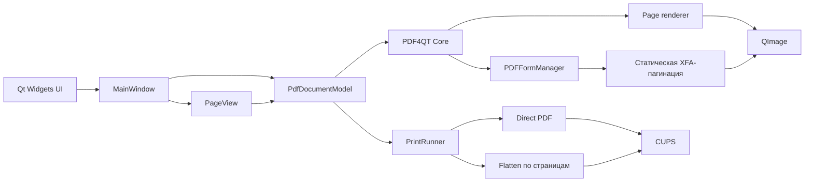

<div align="center">
  
  <h1>pdfly</h1>
  <p><strong>Лёгкий просмотрщик PDF для RedOS 8</strong><br>
  Статические XFA-формы, аккуратный рендеринг и печать через CUPS.</p>

  <p>
    <a href="https://github.com/flytimopheev-sketch/pdfly/releases/latest"></a>
    <a href="LICENSE"></a>
    <a href="https://github.com/flytimopheev-sketch/pdfly"></a>
    
  </p>

  <p><strong>Русский</strong> · <a href="README.en.md">English</a></p>
</div>


## О проекте

**pdfly** — компактный просмотрщик PDF для Linux, собранный на **C++20,
Qt 6 Widgets и PDF4QT Core**. Он открывает обычные PDF и статические
XFA-формы, показывает страницу целиком, поддерживает масштабирование,
поворот страниц, полноэкранный режим и печатает через CUPS. Интерфейс
полностью русский.

Проект намеренно не использует тяжёлое приложение PDF4QT: рендеринг,
наложение аннотаций и печать реализованы явно и разделены на небольшие
компоненты. Это упрощает аудит кода и поведение программы.

Ключевые принципы:

- **Только чтение.** pdfly не изменяет и не сохраняет исходный документ.
- **Без сети и телеметрии.** Приложение работает локально.
- **Предсказуемая печать.** Оригинальный PDF можно отправить в CUPS без
  пересборки, а XFA-формы — растрировать постранично.
- **Одна задача.** Открыть, посмотреть, напечатать.

## Возможности

| Возможность | Что делает pdfly |
| --- | --- |
| Обычные PDF | Постраничный просмотр через PDF4QT, аннотации поверх страницы |
| Статические XFA | Определяет форму, применяет XFA-пагинацию, рисует поля и аннотации |
| Защищённые PDF | Запрашивает пароль; расшифрованные документы не отправляются в CUPS напрямую |
| Навигация | Меню, панель инструментов, клавиатура, номер страницы, drag-and-drop |
| Масштаб | Увеличение, уменьшение, 100 %, по ширине, по странице, Ctrl + колесо |
| Поворот | Влево, вправо и сброс для текущей страницы; влияет только на просмотр |
| Полный экран | F11 и выход по Esc |
| Свойства | Путь, размер файла, число страниц, размер страницы, XFA и шифрование |
| CUPS: напрямую | Передаёт исходные байты PDF — без потери векторов и текста |
| CUPS: flatten | Рендерит страницы в выбранном DPI и отправляет их одним заданием |
| Диапазон страниц | Работает в режиме flatten; DPI 150/300/600 |
| Поля и края | `print-scaling=fit` и полный MediaBox помогают не обрезать поля у края |
| RedOS 8 | Готовый x86_64 RPM с PDF4QT Core внутри пакета |

Поворот страницы действует только на отображение. pdfly не изменяет и не
сохраняет исходный PDF: после закрытия документа ориентация снова будет
исходной.

## Скриншоты

| Главное окно | Статическая XFA-форма |
| --- | --- |
|  |  |

Скриншоты сделаны в реальном приложении под Xvfb, а не нарисованы как макет.

## Горячие клавиши

| Действие | Клавиши |
| --- | --- |
| Открыть PDF | `Ctrl+O` |
| Печать | `Ctrl+P` |
| Свойства документа | `Ctrl+I` |
| Предыдущая / следующая страница | `Page Up` / `Page Down` |
| Первая / последняя страница | `Ctrl+Home` / `Ctrl+End` |
| Увеличить / уменьшить | `Ctrl++` / `Ctrl+-` |
| Масштаб 100 % | `Ctrl+0` |
| По ширине / по странице | `Ctrl+8` / `Ctrl+9` |
| Повернуть по часовой стрелке | `Ctrl+R` |
| Повернуть против часовой стрелки | `Ctrl+Shift+R` |
| Сбросить поворот | `Ctrl+Alt+R` |
| Полноэкранный режим | `F11` |
| Выйти из полноэкранного режима | `Esc` |

Масштаб также меняется колесом мыши при зажатом `Ctrl`.

## Установка

### RedOS 8 x86_64

Скачайте RPM из [последнего релиза](https://github.com/flytimopheev-sketch/pdfly/releases/latest)
и установите его:

```bash
sudo dnf install ./pdfly-0.2.0-1.red80.x86_64.rpm
pdfly --version
pdfly
```

Пакет устанавливает:

```text
/usr/bin/pdfly
/usr/lib64/pdfly/libPdf4QtLibCore.so*
/usr/share/applications/pdfly.desktop
/usr/share/icons/hicolor/scalable/apps/pdfly.svg
/usr/share/licenses/pdfly/
/usr/share/doc/pdfly/
```

PDF4QT Core поставляется внутри пакета в приватном каталоге, поэтому
системная установка PDF4QT не требуется. Qt 6, CUPS и остальные
библиотеки остаются обычными зависимостями RPM. Для русских стандартных
диалогов Qt пакет зависит от `qt6-qttranslations`.

Проверить пакет можно так:

```bash
rpm -qpi pdfly-0.2.0-1.red80.x86_64.rpm
rpm -qpl pdfly-0.2.0-1.red80.x86_64.rpm
rpm -qpR pdfly-0.2.0-1.red80.x86_64.rpm
```

### Запуск

```bash
pdfly
pdfly document.pdf
```

Файл также можно перетащить в окно приложения. После установки pdfly
связывается с MIME-типом `application/pdf`.

## Сборка из исходников

### Зависимости RedOS 8

```bash
sudo dnf install -y \
  gcc-c++ cmake ninja-build git tar gzip rpm-build patchelf python3 \
  qt6-qtbase-devel qt6-qtsvg-devel qt6-qttools-devel cups-devel \
  openssl-devel zlib-devel freetype-devel openjpeg2-devel \
  libjpeg-turbo-devel libpng-devel lcms2-devel tbb-devel
```

`qt6-qttools-devel` нужен PDF4QT во время конфигурации, даже при сборке
только Core-библиотеки.

### PDF4QT Core

pdfly использует PDF4QT Core **1.6.0.0** (проверенный коммит `67b6b99`).
Соберите только ядро и установите его в `/opt/pdf4qt`. Полная инструкция
для RedOS 8, включая сборку `blend2d` и `Clipper2` без vcpkg, находится в
[английском README](README.en.md#redos-8-without-vcpkg).

Краткий вариант, если зависимости уже установлены:

```bash
git clone https://github.com/JakubMelka/PDF4QT.git "$HOME/PDF4QT"
git -C "$HOME/PDF4QT" checkout 67b6b9903cb4e318803342f2d428f02e1bb124e3

cmake -S "$HOME/PDF4QT" -B "$HOME/PDF4QT/build" -G Ninja \
  -DCMAKE_BUILD_TYPE=Release \
  -DCMAKE_PREFIX_PATH=/opt/pdfqt-deps \
  -DPDF4QT_BUILD_ONLY_CORE_LIBRARY=ON \
  -DPDF4QT_BUILD_TESTS=OFF \
  -DPDF4QT_ENABLE_OCR=OFF \
  -DPDF4QT_INSTALL_TO_USR=OFF \
  -DCMAKE_INSTALL_PREFIX=/opt/pdf4qt

cmake --build "$HOME/PDF4QT/build" --parallel
touch "$HOME/PDF4QT/build/pdf4qtlibwidgets_export.h"
sudo cmake --install "$HOME/PDF4QT/build"
```

### Приложение

```bash
cmake -S . -B build -G Ninja \
  -DCMAKE_BUILD_TYPE=Release \
  -DPDF4QT_ROOT=/opt/pdf4qt \
  -DPDFLY_BUILD_SMOKE_TEST=ON

cmake --build build --parallel
./build/pdfly
```

Если PDF4QT установлен в другой префикс, передайте
`-DPDF4QT_ROOT=/путь/к/pdf4qt` или задайте переменную окружения
`PDF4QT_ROOT`.

### RPM для RedOS 8

```bash
./packaging/build-rpm-redos.sh
sudo dnf install ./dist/pdfly-0.2.0-1.red80.x86_64.rpm
```

Скрипт создаёт source-архив из текущего `HEAD`, собирает приложение и
offscreen smoke-тест, запускает `%check` и складывает RPM и `SHA256SUMS`
в `dist/`.

## Архитектура



| Компонент | Ответственность |
| --- | --- |
| `MainWindow` | Меню, панель инструментов, свойства, полный экран, открытие и печать |
| `PageView` | Прокрутка, масштаб, поворот и отрисовка страницы |
| `PdfDocumentModel` | Документ PDF4QT, кэш страниц, XFA, рендеринг |
| `PrintDialog` | Параметры печати с учётом XFA |
| `PrintRunner` | Direct/flatten-задания в CUPS |
| `CupsPrint` | Очереди CUPS и потоковая отправка PDF |

## Печать

Печать работает через локальный CUPS и `libcups`.

1. Настройте принтер и проверьте очередь:
   ```bash
   lpstat -p -d
   ```
2. Откройте документ и выберите **Файл → Печать**.
3. Для обычного PDF по умолчанию используется **Direct PDF**: в CUPS
   уходят исходные байты файла.
4. Для статической XFA-формы автоматически выбирается **Flatten**:
   страницы рендерятся в QImage, собираются в точные одностраничные PDF и
   отправляются как документы одного задания CUPS.
5. При ошибке direct-режима приложение предложит flatten-fallback.

В обоих режимах по умолчанию включено `print-scaling=fit`, чтобы поля у
края страницы не обрезались непечатаемой областью принтера. Для
полнообрезной печати масштабирование можно отключить.

> **Важно:** PDF4QT не предоставляет публичного API для векторного
> «сплющивания» XFA. Поэтому XFA-формы в flatten-режиме растрируются.
> Геометрия, поля и аннотации сохраняются, но текст и графика становятся
> растровыми с выбранным DPI.

## XFA: что поддерживается

pdfly — **read-only** просмотрщик. Он показывает статические XFA-формы,
которые умеет разбирать PDF4QT.

| Поддерживается | Не поддерживается |
| --- | --- |
| Статический XFA `template` | Динамический XFA |
| Пагинация через `performPaging()` | JavaScript и XFA-скрипты |
| Отрисовка полей и аннотаций | FormCalc и вычисления |
| Просмотр и печать | Привязка данных `datasets` |
| Пароль на открытие | Редактирование и сохранение полей |

PDF4QT читает только поток `template`; `datasets`, `script`, `calculate`
и `submit` не исполняются. Это ограничение движка, а не настройка pdfly.
Реальные формы стоит проверять на тестовом документе до промышленной
печати: встроенная XFA-фикстура синтетическая.

## Проверено

| Компонент | Версия |
| --- | --- |
| RedOS | 8 x86_64 |
| GCC | 13.3.1 |
| Qt | 6.9.3 |
| CUPS | 2.4.20 |
| PDF4QT Core | 1.6.0.0, commit `67b6b99` |

Smoke-тесты проверяют обычный рендеринг, статическую XFA, переразбиение
страниц XFA, flatten в точный одностраничный PDF, а также direct-, flatten-
и multi-document-печать через CUPS. Для Ubuntu 26.04 сборка также
проверена с GCC 15.2.0, Qt 6.10.2 и CUPS 2.4.16.

## Структура проекта

```text
CMakeLists.txt
src/
  main.cpp                 точка входа
  mainwindow.*             меню, панель инструментов, свойства, полный экран
  pageview.*               прокрутка, масштаб, поворот и отрисовка страницы
  pdfdocumentmodel.*       PDF4QT, кэш, XFA-пагинация, рендеринг
  cupsprint.*              очереди CUPS и отправка заданий
  printdialog.*            параметры печати
  printrunner.*            direct и flatten-задания
  printsettings.h
testdata/
  make_test_pdfs.py        синтетические PDF и XFA-фикстура
  smoke.cpp                offscreen-тест рендеринга и flatten
  print_smoke.cpp          тест CUPS direct/flatten/multi
packaging/
  pdfly.desktop            ярлык и MIME-связь
  pdfly.svg                иконка приложения
  build-rpm-redos.sh       сборка source-архива и RPM
  rpm/pdfly.spec           spec для RedOS 8
docs/screenshots/          скриншоты приложения
third_party/               лицензии зависимостей PDF4QT
```

## Участие

Issues и пул-реквесты приветствуются. Пожалуйста, прикладывайте версию
ОС, Qt, CUPS, PDF4QT и минимальный PDF, на котором воспроизводится
проблема. Для XFA укажите, является ли форма статической и какие поля
отображаются некорректно.

## Лицензия

Проект распространяется по лицензии **MIT**, см. [LICENSE](LICENSE).
PDF4QT также использует MIT. RPM содержит PDF4QT Core и статически
собранные `blend2d` и `Clipper2`; тексты их лицензий находятся в
[`third_party/`](third_party/).
